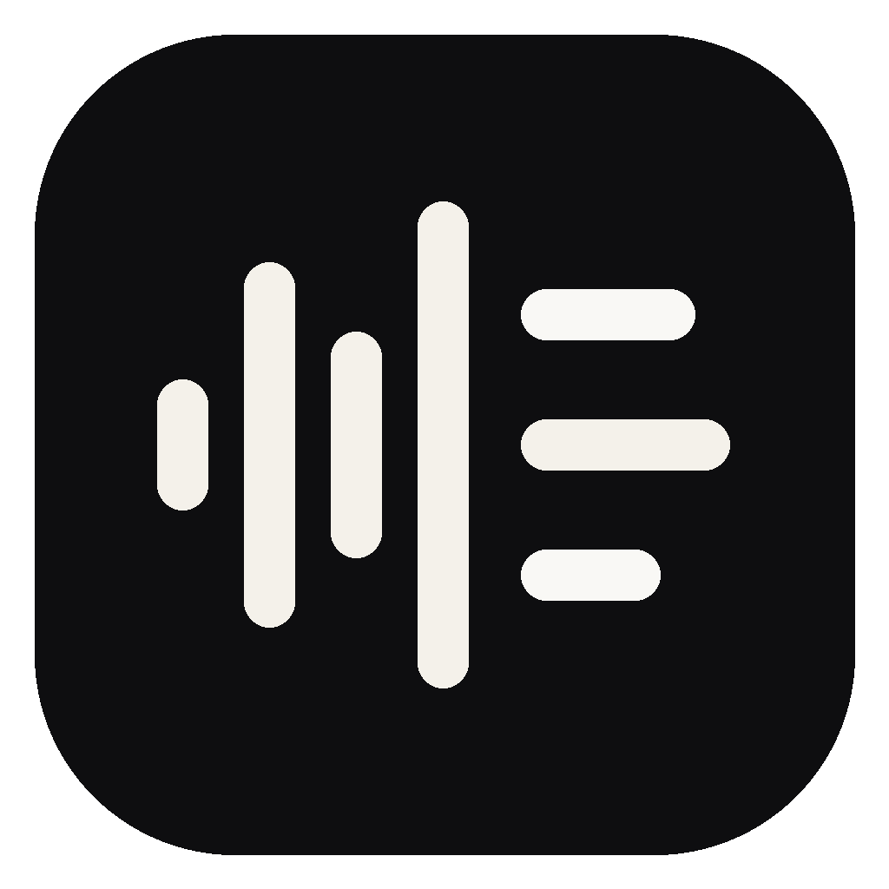
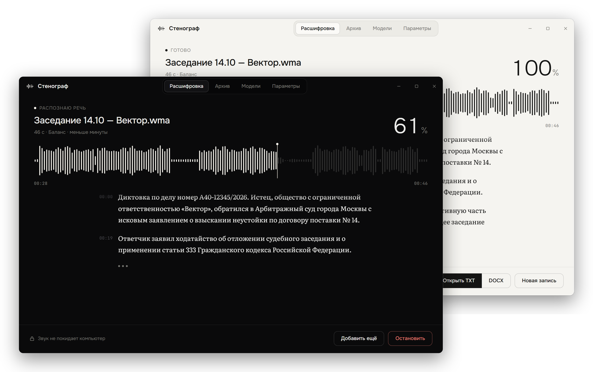
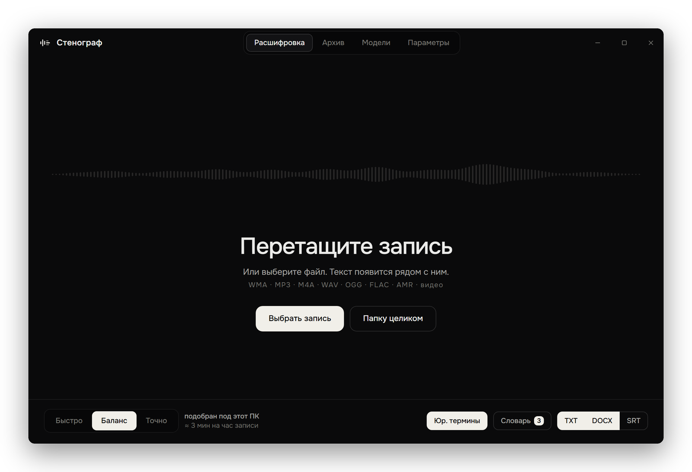
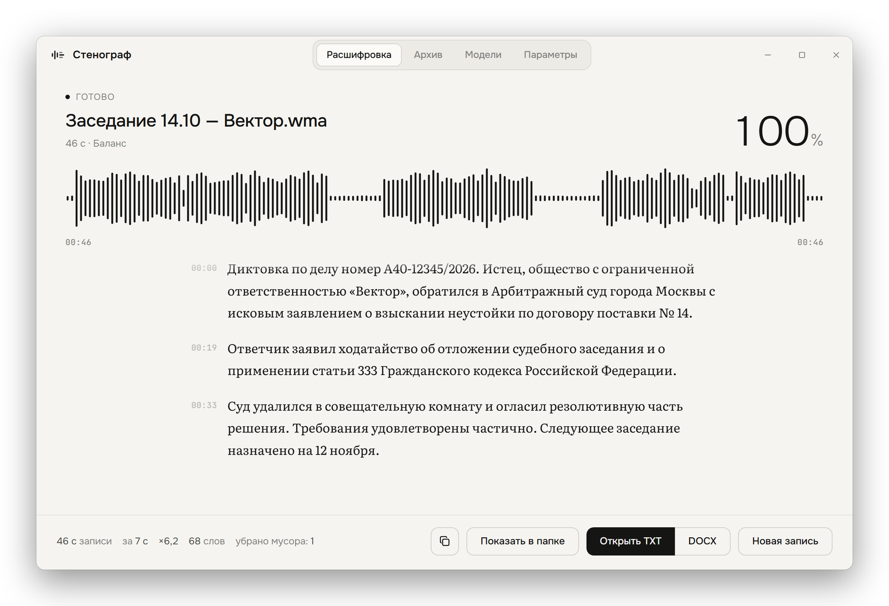
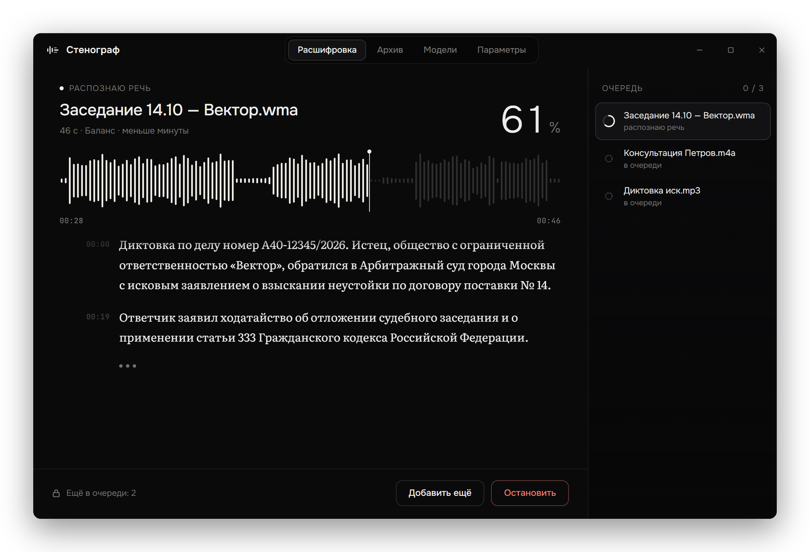
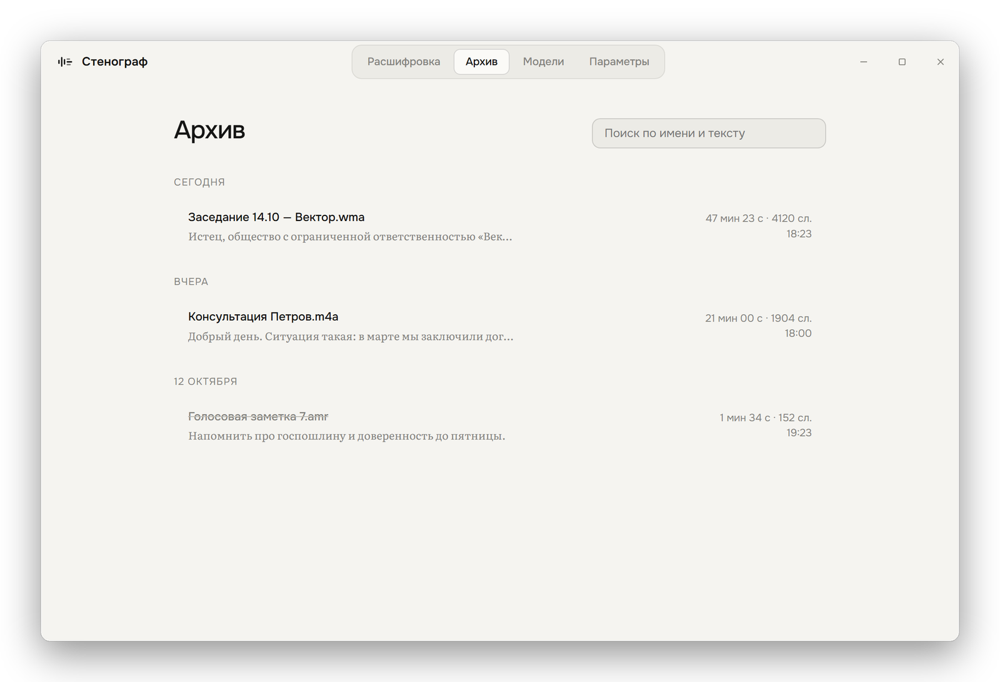
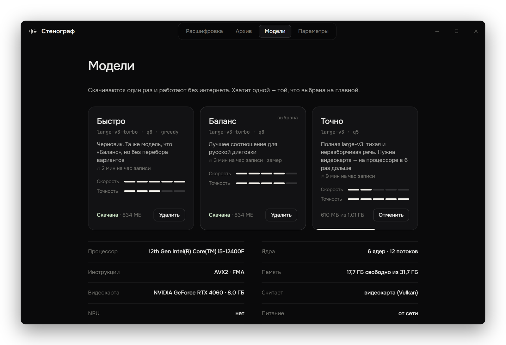
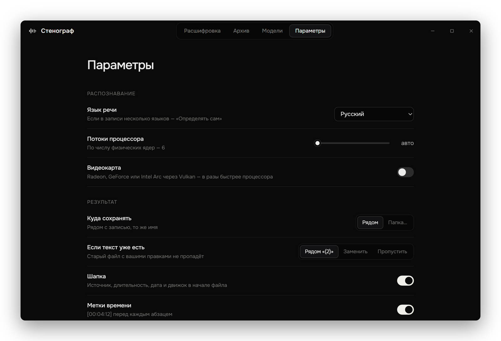

<p align="center">
  
</p>

<h1 align="center">Стенограф</h1>

<p align="center">
  Расшифровка диктофонных записей в текст — на вашем компьютере, без интернета.<br />
  WMA, MP3, M4A, WAV, AMR → TXT, DOCX, SRT.
</p>

<p align="center">
  <a href="https://github.com/Ivantech123/Stenograv_app/releases/latest"></a>
  
  
  
  <a href="LICENSE"></a>
</p>

<p align="center">
  <a href="https://github.com/Ivantech123/Stenograv_app/releases/latest/download/Stenograf_2.0.0_x64-setup.exe"><b>⬇ Скачать для Windows</b></a>
  &nbsp;·&nbsp; 11 МБ &nbsp;·&nbsp;
  <a href="https://github.com/Ivantech123/Stenograv_app/releases">все версии</a>
</p>

<p align="center">
  
</p>

---

## Зачем

Запись заседания, консультации или диктовки нужно превратить в текст, но отдавать её в облачный сервис нельзя. Стенограф распознаёт речь моделью Whisper прямо на компьютере: звук никуда не отправляется, интернет нужен один раз — скачать модель.

## Как пользоваться

1. Перетащите запись в окно (или папку целиком — возьмёт все записи из неё).
2. Смотрите, как текст появляется по ходу распознавания.
3. Готовый файл лежит рядом с записью: то же имя, `.txt` или `.docx`.

<p align="center">
  
  
</p>

## Что умеет

- **Любые записи диктофона**: WMA, MP3, M4A, WAV, OGG, FLAC, AMR, Opus и видео.
- **Три формата**: TXT (сразу открывается в Блокноте), DOCX (Times New Roman 12, абзацный отступ, поля по делопроизводству), SRT (субтитры к видео).
- **Текст абзацами с метками времени** — новый абзац там, где говорящий сделал паузу.
- **Словарь**: имена, названия, номера дел. Без словаря номер вышел «А40 Дефис 12345», со словарём — «А40-12345/2026».
- **Юридические термины**: подсказка модели для «истец», «ходатайство», «ГПК РФ» — сама в текст ничего не вставляет.
- **Чистка мусора Whisper**: фантомные «Субтитры сделал DimaTorzok» и «Продолжение следует…» на тишине, зацикленные повторы.
- **Бережно к вашим правкам**: если текст уже есть, рядом появится `запись (2).txt`, старый не затирается.
- **Очередь**: можно бросить десять файлов и уйти — компьютер не уснёт, по окончании мигнёт иконка на панели задач.
- **Тёмная и светлая тема** — как в Windows.

<p align="center">
  
  
</p>

## Сам подбирает режим под компьютер

При запуске Стенограф смотрит на железо — ядра процессора (отдельно производительные и энергоэффективные), AVX2, свободную память, видеокарту, батарею, место на диске — и выбирает режим, который успеет быстрее реального времени. После первых файлов опирается уже на реальные замеры на этом компьютере. Почему выбран именно этот режим, видно на вкладке «Модели».

| Режим | Модель | Процессор<br><sub>i5-12400F</sub> | Видеокарта<br><sub>RTX 4060</sub> |
|---|---|:-:|:-:|
| Быстро | large-v3-turbo, жадный поиск | ≈ ×2 | ×64 |
| **Баланс** | large-v3-turbo, beam 5 | ×1,7 | ×35 |
| Точно | large-v3, beam 5 | ×0,28 | ×15 |

<sub>«×» — во сколько раз быстрее реального времени, замер на 46 с диктовки. Час записи в «Балансе» на RTX 4060 — меньше 2 минут. «Точно» включается только вручную: на тестах полная large-v3 ошибалась там, где turbo был прав.</sub>

Видеокарта работает через Vulkan: GeForce, Radeon (в том числе встроенные 780M/880M) и Intel Arc.

<p align="center">
  
  
</p>

## Требования

- Windows 10 или 11, 64 бита
- процессор с AVX2 — практически любой с 2013 года
- 8 ГБ памяти, ~1 ГБ на диске под модель
- видеокарта не обязательна, но ускоряет в десятки раз

Установщик ставит программу в профиль пользователя, права администратора не нужны. Он не подписан, поэтому Windows SmartScreen может предупредить: «Подробнее» → «Выполнить в любом случае».

---

## Для разработчиков

```
crates/core   ядро: декодирование, whisper.cpp, чистка текста, файлы, подбор режима
crates/cli    stenograf.exe — то же из командной строки
src-tauri     окно: очередь, поток распознавания, события в интерфейс
ui            интерфейс (HTML/CSS/JS без сборщика)
```

<details>
<summary><b>Путь одного файла</b></summary>

`crates/core/src/job.rs`:

1. **Куда писать.** Если результат уже есть — `запись (2).txt` (в настройках: заменить или пропустить).
2. **Модель.** Первый раз скачивается с докачкой: обрыв на 700 МБ не начинает загрузку заново. Вместе с ней Silero VAD (0,9 МБ).
3. **Звук → 16 кГц моно.** WAV/MP3/FLAC/OGG/M4A декодируются внутри (symphonia + rubato), WMA/AMR/Opus/видео — через ffmpeg, который найдётся или один раз скачается (80 МБ).
4. **Распознавание.** Silero VAD вырезает тишину, затем whisper.cpp; сегменты летят в окно по мере готовности, «Стоп» прерывает сразу.
5. **Чистка** (`filter.rs`): фантомные титры, пометки «[музыка]», петли повторов.
6. **Абзацы и файлы.** Пауза дольше 1,4 с — новый абзац. TXT в UTF-8 с BOM, DOCX по рабочему стандарту, запись атомарная.

Пока идёт расшифровка, компьютер не засыпает, процесс уступает приоритет, на панели задач — прогресс.
</details>

<details>
<summary><b>Определение железа и подбор режима</b></summary>

`crates/core/src/hardware.rs` — WinAPI и реестр, без PowerShell, за миллисекунды: P/E-ядра (`GetLogicalProcessorInformationEx`, E-ядра Intel 12+ тормозят whisper — их не занимаем), AVX2/FMA/AVX-512, свободная память, видеокарты с объёмом видеопамяти, NPU, батарея, место на диске.

`crates/core/src/advisor.rs` оценивает скорость каждого режима, отсекает те, что не влезут в память или на диск, и берёт «Баланс», если он успевает хотя бы ×1, иначе «Быстро». На батарее с зарядом ниже 50% — на ступень легче. Реальная скорость каждой расшифровки сохраняется в `perf.json`; замер одного режима калибрует оценки остальных. Первый файл на видеокарте (компиляция шейдеров) в замеры не идёт.
</details>

<details>
<summary><b>Сборка</b></summary>

Нужны Rust, Node.js, Python, Visual Studio Build Tools 2022 (C++) и CMake.

```powershell
.\scripts\setup-dev.ps1                                # libclang и Vulkan SDK в tools\ — без установки в систему
$env:CARGO_TARGET_DIR = "C:\stg"; npm run build:gpu    # установщик NSIS
cargo build --release -p stenograf-cli                 # только консольная версия, CPU
cargo test -p stenograf-core
python scripts\make-screenshots.py                     # скриншоты для README
```

Неочевидное (всё в `.cargo/config.toml`):

- крейт `cmake` подменяет флаги MSVC и теряет `/O2` — без явного `CMAKE_C_FLAGS_RELEASE` whisper.cpp в десятки раз медленнее;
- `GGML_NATIVE=OFF` + AVX2/FMA/F16C — сборка запускается на любом x86 с 2013 года, а не только там, где собрана;
- готовые биндинги whisper-rs сделаны под Linux, поэтому нужен libclang;
- для GPU-сборки `CARGO_TARGET_DIR` должен быть коротким: шейдеры Vulkan собираются во вложенном CMake-проекте, и MSBuild упирается в 260 символов пути.
</details>

<details>
<summary><b>Командная строка</b></summary>

```powershell
stenograf запись.wma
stenograf D:\диктофон --out D:\тексты --docx
stenograf запись.wma --preset accurate --legal --words "Иванов, А40-12345/2026"
stenograf --doctor      # железо, модели, оценки скорости и рекомендованный режим
```
</details>

Данные программы — в `%LOCALAPPDATA%\Stenograf`: модели, ffmpeg, `settings.json`, `history.json`, `perf.json`.

## Лицензия

MIT. Распознавание — [whisper.cpp](https://github.com/ggml-org/whisper.cpp) (MIT) и модели [OpenAI Whisper](https://github.com/openai/whisper) (MIT), вырезание тишины — [Silero VAD](https://github.com/snakers4/silero-vad) (MIT). Шрифты Onest, Literata, JetBrains Mono — SIL OFL 1.1.
